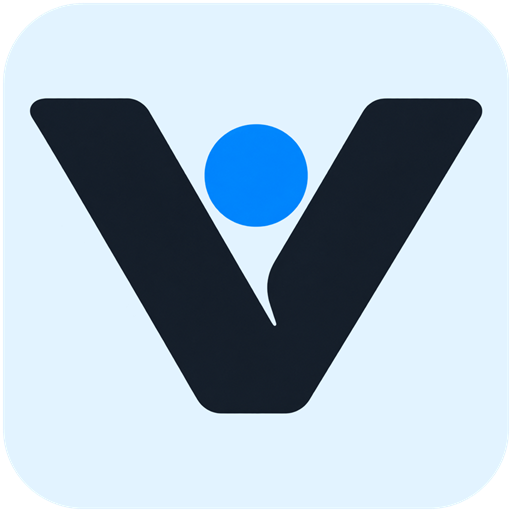

<p align="center">
  
</p>

# Vertex

> [!NOTE]
> **项目仍在开发中**：Vertex 的部分功能和体验尚在完善，使用过程中可能遇到 Bug 或其他异常。如果发现问题，欢迎通过 [GitHub Issues](https://github.com/xyuqikzz/vertex-mods/issues) 反馈，并尽量附上客户端版本、复现步骤，以及相关截图或脱敏日志，帮助我们更快定位问题、修复和迭代。
>
> **Under active development**: Some features and workflows are still being refined, and you may encounter bugs or unexpected behavior. Please report problems through [GitHub Issues](https://github.com/xyuqikzz/vertex-mods/issues), ideally including your client version, steps to reproduce, and relevant screenshots or redacted logs. Your feedback helps us diagnose issues, deliver fixes, and improve Vertex more quickly.

面向 Windows 的游戏与模组管理客户端。管理游戏、浏览模组、编排安装任务，并在需要时使用 AI 助手。

A Windows desktop client for managing games, discovering mods, coordinating installations, and working with an AI assistant.

[简体中文](#zh-cn) · [English](#english) · [GitHub](https://github.com/xyuqikzz/vertex-mods) · [Releases](https://github.com/xyuqikzz/vertex-mods/releases)

<a id="zh-cn"></a>

## 简体中文

### 项目简介

Vertex 将游戏库、多来源模组、下载与安装任务放在同一个桌面工作区中。客户端基于 Electron、Vue 3 和 JavaScript，面向 Windows x64；原生模块、注册表和系统工具依赖 Windows，不提供 macOS / Linux 的完整运行支持。

本仓库包含客户端源码、必要的构建打包工具，以及随客户端分发的必要资源。业务后端和 Vertex 原生扩展的源码属于独立项目，不包含在此仓库中。

### 主要功能

- **游戏库**：扫描和手动添加本地游戏，管理游戏目录、启动入口与快捷启动。
- **模组管理**：按游戏和来源浏览模组，管理安装记录、配置档案、启用状态及卸载操作。
- **统一任务中心**：查看下载、安装、进度与诊断信息，并按任务类型执行暂停、取消或重试。
- **安装规则与整合包**：使用声明式规则规划安装，管理依赖和安装目标；支持适用来源的在线整合包以及 `.vxpack` 离线包导入导出。
- **AI 助手**：结合当前游戏与页面上下文搜索模组、准备安装方案、分析日志和排查失败。角色、技能和工具可配置，写入操作受授权与确认机制约束。
- **游戏与系统工具**：集成 DLSS5 组件管理、风灵月影工具入口、设备信息、应用卸载及系统优化工具。
- **语言与内容翻译**：提供简体中文、English 和跟随系统选项；界面语言与模组内容翻译分别设置，内容翻译使用微软翻译。

### 模组来源

| 来源 | 客户端能力与条件 |
| --- | --- |
| Nexus Mods | 浏览、搜索、文件选择与规则安装；使用用户自己的账号授权或 API Key，下载能力取决于平台权限。 |
| mod.io | 浏览、搜索和规则安装；需在设置中提供有效 API 配置。 |
| Thunderstore | 浏览、安装、依赖与配置管理，并支持相关整合包流程。 |
| Ficsit | 从聚合来源进入，支持 Satisfactory 模组浏览、依赖和安装。 |
| VAM-Hub | 浏览、文件选择和规则安装；受限内容需要有效的来源授权。 |
| GameBanana | 游戏目录与模组浏览、文件下载；有适用公共安装规则且识别到游戏目录时可安装，否则仅下载。 |
| Steam Workshop | 工坊浏览与下载，按内容要求进行 Steam 授权；有适用公共规则和游戏目录时可安装，否则仅下载。 |

来源浏览、下载、规则安装和 AI 支持是不同能力，不代表所有游戏或模组都可自动安装。旧 Vertex 自有在线模组来源已停用，历史安装记录仍可在本地管理中维护。

### 从源码开始

开发环境使用 **Windows x64、Node.js 22.16.0、npm 10.9.2**，与 `.nvmrc` 和 CI 保持一致。依赖以 [package-lock.json](./package-lock.json) 为准。

在 PowerShell 中执行：

```powershell
git clone https://github.com/xyuqikzz/vertex-mods.git
cd vertex-mods
Copy-Item .env.example .env
npm ci
npm run dev
```

复制配置后，按自己的运行环境调整 `.env`。已有本地配置时不要覆盖；开发模式会启动完整 Electron 客户端，单独打开前端页面不能替代 IPC 和原生能力。

`npm ci` 会安装锁定依赖，并通过 `postinstall` 显式安装 Electron 运行程序，再准备原生依赖。首次安装可能需要下载 Electron；下载失败时依赖安装会报错。若预编译包不可用、需要本地编译，请准备 Python 和 Visual Studio C++ Build Tools（包含“使用 C++ 的桌面开发”工作负载）。

### 配置与首次使用

[.env.example](./.env.example) 只用于公开的构建配置：

| 配置 | 用途 |
| --- | --- |
| `VITE_APP_NAME` / `VITE_APP_ID` | 应用名称和应用标识。 |
| `VITE_LOCAL_NAME` / `VITE_LOCAL_ID` | 本地数据目录名称及可选后缀；独立发行版应使用独立目录。 |
| `VITE_REQUEST_API` | Vertex 业务后端地址。 |
| `VITE_APP_VERSION` | 客户端版本配置。 |
| `VITE_NEXUS_API_BASE_URL` / `VITE_THUNDERSTORE_BASE_URL` | 对应来源的公共接口地址，可按构建环境配置。 |

示例目前指向项目维护者的业务后端。账号、部分游戏目录与公共安装规则等功能依赖相应服务；克隆客户端仓库不会同时部署后端。自行部署时请替换接口地址，并确认后端契约兼容。

首次启动后，在设置中选择界面语言、下载位置与所需来源的授权方式。AI 助手需单独配置模型服务。Nexus、mod.io、AI 的密钥及 VAM-Hub Cookie 通过客户端设置提供，不放入 `.env`、源码或提交记录。只有 [公开配置清单](./scripts/public-build-env.mjs) 中的构建变量会被显式注入，但进入客户端产物的配置仍不适合保存秘密。

界面支持中英文切换，具体页面覆盖仍在完善；回退文案不等于已经完成翻译。英文界面默认展示模组来源原文，不读取或生成中文内容译文；已有中文缓存保留，切回中文后可继续使用。网页主动翻译与搜索关键词转换有各自的规则。

远程使用统计和错误报告默认关闭，可在隐私设置中开启。本地诊断日志与远程上报分别管理。

### 构建与更新

| 命令 | 结果 |
| --- | --- |
| `npm run build` | 编译主进程、预加载脚本和渲染进程，输出到 `out/`。 |
| `npm run start` | 运行已经构建的客户端。 |
| `npm run build:unpack` | 构建 Windows 目录包，输出到 `dist/`。 |
| `npm run build:win` | 构建 Windows NSIS 安装包，输出到 `dist/`。 |

两个打包入口均使用 `--publish never`，不会自动上传发行物。打包会准备并校验固定版本的 DLSS5 组件，首次运行可能需要联网下载；校验失败会中止打包。开发时需要这些组件，可运行 `node scripts/prepare-dlss-payload.mjs` 单独准备。

[Build Windows 工作流](./.github/workflows/build-windows.yml) 在推送 `v*` 标签时自动运行，也可在 GitHub Actions 中手动触发。标签须与 `package.json` 和 `.env.example` 的版本一致，例如 `v2.0.0`。工作流在 Windows x64 环境扫描源码凭据、安装锁定依赖并审计依赖，然后生成安装包、SHA-256 文件和 `latest.yml` 自动更新元数据，保存为 `Vertex-2.0.0-windows-x64`（版本号随源码变化）产物，保留 30 天。标签构建成功后，独立发布任务再次校验安装包 SHA-256，并将安装包、校验文件及 `latest.yml` 作为附件发布到对应的 GitHub Release；在普通分支上手动运行时只生成 Actions 产物。当前未配置代码签名证书，产物为未签名安装包。已有 Release 不会被静默覆盖。

普通构建直接使用 [resources/node](./resources/node) 中的原生模块，不自动重建或替换它们。只有需要更新原生能力时，才先从匹配版本的原生源码构建，再运行 `node scripts/sync-node-api.cjs --check` 检查，最后通过 `npm run sync:napi` 同步；其他源码位置可由 `VERTEX_NODE_API_ROOT` 指定。

原生源码已在 [GitHub](https://github.com/xyuqikzz/vertex-node-api) 开源；公开快照与当前随包原生模块存在接口差异，构建及兼容性边界见 [NATIVE_BUILD.md](./NATIVE_BUILD.md)。Windows 打包固定使用 electron-builder 26.18.1；打包钩子包含该版本 npm 依赖 JSON 输出的兼容处理，升级构建器时需一并复核。

Steam 工具的源码包、许可证和摘要清单位于 [resources/workshop](./resources/workshop)。需要重建时使用 `node scripts/build-workshop-tool.mjs`；这一步另需匹配上游项目要求的 .NET SDK，并会更新工具包和摘要清单。

发行渠道由 [release-config.json](./src/shared/app/release-config.json) 管理。默认社区渠道检查本仓库的 GitHub 正式 Release。发布说明支持安全 Markdown；提供匹配的 Windows 安装包和 `latest.yml` 时可点击“下载并安装”，通过摘要、签名及发布者校验后自动退出、安装并重新打开；关闭下载弹窗或选择“稍后安装”会保留下载但取消自动安装。缺少更新元数据时仍可打开发布页查看。没有公开 Release、网络失败和限流会作为独立状态提示。`official` / `custom` 渠道可配置 HTTPS 更新源。安装包以 [Releases](https://github.com/xyuqikzz/vertex-mods/releases) 为准，尚未发布时可按上述步骤构建。

原 DLSS NR 兼容归档的 GitHub 地址已不可用。云端工作流从 SourceForge 镜像获取同一版本，通过仓库锁定的大小和 SHA-256 校验后，使用 `VERTEX_DLSS_SWAPPER_ARCHIVE` 交给现有打包钩子。钩子只解包并验证所需组件，不运行该上游安装程序；本地打包也可通过这个变量指定已校验的归档。

社区版 NSIS 打包会写入指向本仓库的 `app-update.yml`，供更新器读取下载缓存配置；打包命令仍使用 `--publish never`。

仓库私有时，普通客户端无法匿名获取 Release；此流程面向仓库后续公开发行。未签名安装包不能自动安装，也不会绕过现有发布者校验。首次启用正式代码签名时，原未签名客户端需先手动安装受信任的新版本。安装与重启的真实验收需要相同发布者的已签名客户端和安装包。

### 开发与验证

- `npm run lint`：代码检查；`npm run lint:format`：同时检查格式。
- `npm run format`：格式化代码，会修改文件，提交前核对差异。
- `npm run build`：构建客户端；`npm run check:bundle-size`：检查构建产物体积。

`scripts/` 只保留构建、打包、第三方声明生成和原生资源维护工具。自动化测试与阶段验收脚本已移除。构建通过后，仍需按变更范围检查中英文界面、启动、安装和回滚等实际路径；涉及真实账号、下载或用户目录写入时，先确认授权并使用隔离环境。

临时验证优先在终端内执行；确需文件时放在已忽略的 `.scratch/verification/<任务名>/`，脚本、夹具和结果集中存放，任务结束清理本次生成且不再需要的文件。不要在 `scripts/` 中重新积累测试、冒烟或阶段验收脚本，也不要默认重建测试框架和登记清单。

贡献时请沿用 JavaScript、现有架构与 `Vx*` 组件体系；新增用户可见文案同时提供中英文，跨进程参数保持可结构化克隆。不要提交本地凭据、用户数据、缓存和测试产物。提交问题时请说明客户端版本、Windows 版本、来源、复现步骤及脱敏日志。

### 目录与文档

数据库按 `games`、`mods`、`files`、`sources`、`cache` 和 `migrations` 分域；连接与初始化入口保留在 `src/main/db` 根目录。仓储不依赖 IPC，文件校验、删除和缓存清理由服务层组合执行。

Trainer、文件资产、下载存储、档案存储和缓存迁移分别归入 `services/trainers`、`managed-files`、`downloads`、`profiles`、`storage-migration`。这些模块不得直接或间接依赖 IPC 注册文件或应用启动入口；`ipc/gameTools` 保留通道与参数适配，并复用统一安全包装。其他较大的安装和任务模块仍在分批整理中。

主窗口引用由 `main/windows/mainWindow.js` 持有，功能模块不反向导入启动入口。修改依赖时应同时核对静态与动态导入、require 及原生扩展加载边界。

`src/shared` 按业务域组织，具体边界见 [共享模块说明](./src/shared/README.md)。AI 的配置、会话、权限、工具、安装协作和就绪检查各有目录；安装规则及编译器统一放入 `installation`，来源协议归入 `sources`，整合包契约归入 `modpacks`。共享层只保留跨进程可复用的纯逻辑和数据，不依赖主进程、渲染进程、Electron 或 Node 内置模块。调用方直接导入所属模块，不使用根目录总导出或旧路径转发文件。

Trainer 文件操作只处理主进程登记的 FLiNG 下载，拒绝路径穿越、符号链接和目录联接。清除下载记录后，旧路径不能单独获得操作权限。服务返回稳定错误码和消息键，由适配层提供双语提示。

| 位置 | 内容 |
| --- | --- |
| [src/main](./src/main) | Electron 主进程、IPC、业务服务与本地数据访问。 |
| [src/preload](./src/preload) | 主进程与渲染进程之间的受控桥接。 |
| [src/renderer/src](./src/renderer/src) | Vue 页面、组件、状态与国际化。 |
| [src/shared](./src/shared) | 跨进程共享的规则、类型约定和能力声明。 |
| [resources](./resources) / [tools](./tools) | 运行资源、原生模块及第三方工具集成源码。 |
| [scripts](./scripts) | 构建、打包、原生资源维护与第三方声明生成。 |
| [安装规则入门](./src/renderer/src/docs/source-install-rule-user-guide.md) | 面向规则使用者的说明。 |
| [安装规则技术参考](./src/renderer/src/docs/install-rule-reference.md) | 规则结构、执行语义与能力边界。 |
| [智能体默认配置](./src/shared/ai/config/ai-agent-definition.json) | 角色、技能、工具和运行参数的默认值。 |

### 许可证与第三方项目

Vertex 自有代码版权归 Copyright (c) 2026 YuQiKzz 所有，采用 [GNU GPL 第 3 版许可证](./LICENSE)（仅第 3 版，`GPL-3.0-only`）。允许商用；分发受该许可证覆盖的程序及其修改版时，须按 GPL 提供对应源码及许可声明。第三方代码、工具、字体和素材保留各自许可及声明；具体边界和待核实的素材见 [第三方声明](./THIRD_PARTY_NOTICES.md)。安全问题请按 [SECURITY.md](./SECURITY.md) 私下报告。

集成项与依赖资料见 [third-party-projects.json](./src/shared/app/third-party-projects.json)。随附声明位于 [resources/licenses](./resources/licenses) 和 [resources/workshop](./resources/workshop)；分发时保留相应许可证、声明及配套源码材料。客户端“关于”页面提供集成工具索引。

---

<a id="english"></a>

## English

### About

Vertex brings a local game library, multiple mod sources, downloads, and installation tasks into one desktop workspace. It is built with Electron, Vue 3, and JavaScript for Windows x64. Native modules, registry access, and system tools depend on Windows; full macOS and Linux support is not provided.

This repository contains the desktop client, essential build and packaging tools, and required bundled resources. The business backend and the source code for Vertex's native extensions are separate projects and are not included here.

### Features

- **Game library**: scan for local games, add them manually, manage game directories and launch targets, and use quick launch.
- **Mod management**: browse by game and source, and manage installation records, profiles, enabled states, and removal.
- **Unified task center**: follow downloads, installations, progress, and diagnostics, with pause, cancellation, or retry where supported.
- **Installation rules and modpacks**: plan deployments with declarative rules, dependencies, and destination mappings; use online modpacks for supported sources and import or export `.vxpack` offline packages.
- **AI assistant**: use the current game and page context to search for mods, prepare installation plans, analyze logs, and investigate failures. Roles, skills, and tools are configurable; writes remain subject to authorization and confirmation policies.
- **Game and system tools**: access DLSS5 component management, FLiNG tools, device information, application removal, and system optimization tools.
- **Languages and translation**: choose Simplified Chinese, English, or the system language. Interface language and mod content translation are separate settings; content translation uses Microsoft Translator.

### Mod sources

| Source | Capabilities and requirements |
| --- | --- |
| Nexus Mods | Browsing, search, file selection, and rule-based installation. Use your own account authorization or API key; downloads depend on platform permissions. |
| mod.io | Browsing, search, and rule-based installation. Requires valid API settings. |
| Thunderstore | Browsing, installation, dependencies, configuration management, and supported modpack workflows. |
| Ficsit | Available through aggregated sources for Satisfactory mod browsing, dependencies, and installation. |
| VAM-Hub | Browsing, file selection, and rule-based installation. Restricted content requires valid source authorization. |
| GameBanana | Game and mod browsing with file downloads. Installation requires an applicable shared rule and an identified game directory; otherwise, files are downloaded only. |
| Steam Workshop | Workshop browsing and downloads, with Steam authorization when required. Installation needs an applicable shared rule and a game directory; otherwise, files are downloaded only. |

Browsing, downloading, rule-based installation, and AI support are separate capabilities. Support for a source does not mean every game or mod can be installed automatically. The former Vertex-hosted online mod source has been retired; existing installation records remain manageable locally.

### Getting started from source

Use **Windows x64, Node.js 22.16.0, and npm 10.9.2**, matching `.nvmrc` and CI. [package-lock.json](./package-lock.json) defines the dependency versions.

Run in PowerShell:

```powershell
git clone https://github.com/xyuqikzz/vertex-mods.git
cd vertex-mods
Copy-Item .env.example .env
npm ci
npm run dev
```

Adjust `.env` for your environment after copying it. Do not overwrite an existing local configuration. Development mode starts the full Electron client; opening only the frontend does not provide its IPC bridge or native capabilities.

`npm ci` installs locked dependencies. Its `postinstall` step explicitly installs the Electron executable before preparing native dependencies. The first installation may download Electron; a failed download causes dependency installation to fail. If a prebuilt dependency is unavailable and a local build is required, install Python and Visual Studio C++ Build Tools with the “Desktop development with C++” workload.

### Configuration and first launch

[.env.example](./.env.example) contains public build settings only:

| Setting | Purpose |
| --- | --- |
| `VITE_APP_NAME` / `VITE_APP_ID` | Application name and identity. |
| `VITE_LOCAL_NAME` / `VITE_LOCAL_ID` | Local data directory name and optional suffix. Independent distributions should use a separate directory. |
| `VITE_REQUEST_API` | Vertex business backend URL. |
| `VITE_APP_VERSION` | Client version setting. |
| `VITE_NEXUS_API_BASE_URL` / `VITE_THUNDERSTORE_BASE_URL` | Public source API endpoints, configurable for the build environment. |

The example currently points to the maintainer's backend. Accounts, some game catalogs, and shared installation rules depend on those services. Cloning this client does not deploy a backend. For your own deployment, change the endpoint and ensure the backend API contract is compatible.

After launching, choose an interface language, download location, and authorization method for the sources you use. Configure a model service separately for the AI assistant. Enter Nexus, mod.io, and AI keys and VAM-Hub cookies through client settings; keep them out of `.env`, source files, and commits. Only variables in the [public build allowlist](./scripts/public-build-env.mjs) are explicitly injected, but any configuration included in a client build is still unsuitable for storing secrets.

The interface supports switching between Chinese and English, with page coverage still being improved. Fallback text does not count as a completed translation. In English mode, mod content uses the source's original text without reading or generating Chinese translations. Existing Chinese caches are retained and can be used again after switching back. Explicit webpage translation and search keyword conversion follow separate rules.

Remote usage statistics and error reporting are disabled by default and can be enabled in privacy settings. Local diagnostic logs are managed separately from remote reporting.

### Building and updates

| Command | Result |
| --- | --- |
| `npm run build` | Build the main process, preload scripts, and renderer into `out/`. |
| `npm run start` | Run the previously built client. |
| `npm run build:unpack` | Build an unpacked Windows application into `dist/`. |
| `npm run build:win` | Build a Windows NSIS installer into `dist/`. |

Both packaging commands use `--publish never` and do not upload releases. Packaging prepares and verifies pinned DLSS5 components; the first run may need network access. Verification failures stop packaging. To prepare these components for development, run `node scripts/prepare-dlss-payload.mjs` separately.

The [Build Windows workflow](./.github/workflows/build-windows.yml) runs when a `v*` tag is pushed and can also be started manually in GitHub Actions. The tag must match the versions in `package.json` and `.env.example`, for example `v2.0.0`. On Windows x64, it scans source history for credentials, installs and audits locked dependencies, and packages the installer with a SHA-256 file and `latest.yml` auto-update metadata. The `Vertex-2.0.0-windows-x64` artifact (named for the source version) is retained for 30 days. After a successful tag build, a separate publishing job verifies the installer SHA-256 again and attaches the installer, checksum, and `latest.yml` to the corresponding GitHub Release. Manual runs on ordinary branches only produce Actions artifacts. No code-signing certificate is configured, so the installer is unsigned. Existing releases are not silently overwritten.

Normal builds use the native modules in [resources/node](./resources/node) without rebuilding or replacing them. To update native functionality, build matching native sources first, validate them with `node scripts/sync-node-api.cjs --check`, then run `npm run sync:napi`. Set `VERTEX_NODE_API_ROOT` when the native project is in a different location.

The native source is open on [GitHub](https://github.com/xyuqikzz/vertex-node-api). The published snapshot has interface differences from the bundled binaries; see [NATIVE_BUILD.md](./NATIVE_BUILD.md) for build and compatibility limitations. Windows packaging pins electron-builder to 26.18.1. Its packaging hook handles extra text around npm's dependency JSON for this version; review that compatibility handling when upgrading the builder.

The Steam tool's source archive, license, and hash manifest are in [resources/workshop](./resources/workshop). Rebuild it with `node scripts/build-workshop-tool.mjs` when needed. This requires a .NET SDK compatible with the upstream project and updates the tool archive and hash manifests.

[release-config.json](./src/shared/app/release-config.json) controls the release channel. The default community channel checks this repository's stable GitHub Releases and renders release notes as safe Markdown. When the release includes the matching Windows installer and `latest.yml`, Download and install verifies the checksum, signature, and publisher, then exits, installs, and reopens Vertex automatically. Closing the download dialog or choosing Install later keeps the download but cancels automatic installation. Releases without update metadata retain the release-page fallback. Missing public releases, network errors, and rate limits are reported separately. The `official` and `custom` channels can use an HTTPS update feed. Check [Releases](https://github.com/xyuqikzz/vertex-mods/releases) for installers, or build from source if no release is available.

The original GitHub URL for the DLSS NR compatibility archive is no longer available. The workflow obtains the same version from SourceForge, checks its size and SHA-256 against the repository's lock, and supplies it to the existing packaging hook through `VERTEX_DLSS_SWAPPER_ARCHIVE`. The hook extracts and verifies only the required components; it does not run the upstream installer. Local builds can use the same variable to supply a verified archive.

Community NSIS builds include an `app-update.yml` pointing to this repository, which also supplies the updater's download cache configuration. Packaging commands still use `--publish never`.

Anonymous clients cannot access releases while the repository is private; this flow is intended for its future public distribution. Unsigned installers cannot be installed automatically, and publisher checks remain enforced. When code signing is first enabled, users of the unsigned client must manually install a trusted new version. Real installation and restart acceptance requires a signed client and installer from the same publisher.

### Development and verification

- `npm run lint` checks code; `npm run lint:format` also checks formatting.
- `npm run format` rewrites files. Review the diff before committing.
- `npm run build` builds the client; `npm run check:bundle-size` checks output size budgets.

`scripts/` contains only build, packaging, third-party notice generation, and native resource maintenance tools. Automated tests and milestone acceptance scripts have been removed. After building, verify the affected Chinese and English UI, startup, installation, and rollback paths as appropriate. Work involving real accounts, downloads, or user-directory writes requires authorization and an isolated environment.

Prefer inline terminal checks for temporary verification. When files are needed, keep scripts, fixtures, and results together under the ignored `.scratch/verification/<task>/` directory, then remove files created by the task that are no longer needed. Do not accumulate tests, smoke checks, or milestone scripts in `scripts/`, or recreate a test framework and registry by default.

When contributing, follow the existing JavaScript architecture and `Vx*` component system. Provide Chinese and English text for new UI copy, and keep IPC payloads structured-cloneable. Exclude local credentials, user data, caches, and test output from commits. Bug reports should include the client and Windows versions, source, reproduction steps, and redacted logs.

### Repository layout and documentation

Database modules are grouped by games, mods, files, sources, cache and migrations. Trainer, managed-file, download-storage and profile services share explicit boundaries. Feature modules read the main-window reference from `main/windows/mainWindow.js` instead of importing the application entry point.

`src/shared` is organized by business domain; see the [shared module guide](./src/shared/README.md). AI configuration, conversations, permissions, tools, installation coordination and readiness checks have separate directories. Installation rules and their compiler live in `installation`, source contracts in `sources`, and modpack contracts in `modpacks`. Shared modules contain reusable logic and data without main-process, renderer, Electron or Node built-in dependencies. Import each module directly; there is no root barrel or forwarding layer for old paths.

Trainer file operations require a matching FLiNG download record and reject traversal, symbolic links and directory junctions. Removing the download record also removes permission to operate on its old path. Services return stable error codes and message keys for localized UI messages.

| Location | Contents |
| --- | --- |
| [src/main](./src/main) | Electron main process, IPC handlers, business services, and local data access. |
| [src/preload](./src/preload) | Controlled bridge between the main process and renderer. |
| [src/renderer/src](./src/renderer/src) | Vue pages, components, state, and internationalization. |
| [src/shared](./src/shared) | Shared rules, data contracts, and capability declarations. |
| [resources](./resources) / [tools](./tools) | Runtime assets, native modules, and third-party tool integration sources. |
| [scripts](./scripts) | Build, packaging, native resource maintenance, and third-party notices. |
| [Installation rule guide](./src/renderer/src/docs/source-install-rule-user-guide.md) | Introduction for installation rule users. |
| [Installation rule reference](./src/renderer/src/docs/install-rule-reference.md) | Rule structure, execution semantics, and capability boundaries. |
| [Default agent configuration](./src/shared/ai/config/ai-agent-definition.json) | Default roles, skills, tools, and runtime settings. |

### License and third-party projects

Vertex's original code is Copyright (c) 2026 YuQiKzz and licensed under the [GNU General Public License, version 3 only](./LICENSE) (`GPL-3.0-only`). Commercial use is permitted. Distribution of covered programs and modified versions must comply with the GPL's corresponding-source and notice requirements. Third-party code, tools, fonts, and assets retain their own terms and notices; see [third-party notices](./THIRD_PARTY_NOTICES.md), including assets awaiting provenance verification. Report security issues privately as described in [SECURITY.md](./SECURITY.md).

Integration and dependency metadata is maintained in [third-party-projects.json](./src/shared/app/third-party-projects.json). Bundled notices are in [resources/licenses](./resources/licenses) and [resources/workshop](./resources/workshop). Keep the applicable licenses, notices, and accompanying source materials with distributions. The client's About page provides an index of integrated tools.

---

<a id="maintainer-reference"></a>

<details>
<summary>维护者附录：AI 工具与来源范围 / Maintainer appendix: AI tools and sources</summary>

### 工具与来源范围 / Tools and source coverage

当前 Agent 工具数量：49 个。工具名称与定义以 [工具 schema](./src/shared/ai/tools/ai-agent-tool-schemas.js) 为准：`vertex.skill.read`、`vertex.dlss.list`、`vertex.dlss.inspect`、`vertex.dlss.prepare`、`vertex.dlss.execute`、`vertex.dlss.check_runtime`、`vertex.game.list`、`vertex.game.context`、`vertex.game.detect_root`、`vertex.game.bind_root`、`vertex.mod.installed_list`、`vertex.mod.installed_detail`、`vertex.mod.search`、`vertex.mod.detail`、`vertex.install.tasks`、`vertex.install.task_detail`、`vertex.install.task_timeline`、`vertex.install.failure_diagnose`、`vertex.page.context`、`vertex.source.capabilities`、`vertex.source_credential.status`、`vertex.source_credential.configure`、`vertex.install.control_task`、`vertex.install_rule.reference_docs`、`vertex.install_rule.save_config`、`vertex.log.analyze`、`vertex.rollback.plan`、`vertex.rollback.execute`、`vertex.install.resolve_dependencies`、`vertex.install.context_audit`、`vertex.install.archive.inspect`、`vertex.install.location_hints`、`vertex.install.rule.match_preview`、`vertex.install.inspect_plan`、`vertex.install.execute_plan`、`vertex.trainer.fling.search`、`vertex.trainer.fling.detail`、`vertex.trainer.fling.download`、`vertex.trainer.fling.local_records`、`vertex.trainer.fling.run`、`vertex.script.prepare`、`vertex.script.run`、`vertex.local_mod.analyze`、`vertex.mod.update_check`、`vertex.mod.lifecycle_plan`、`vertex.mod.lifecycle_execute`、`vertex.conflict.detect`、`vertex.conflict.repair_plan`、`vertex.conflict.execute_repair`。

The current agent exposes 49 tools. The identifiers above are shared across both languages; their definitions are maintained in the linked tool schema.

AI 安装预检来源：`nexus`、`modio`、`ficsit`、`custom`。Thunderstore 当前可 AI search/detail，但不进入 AI 安装预检来源。Vertex 自有在线来源已退出，不能用于 AI 搜索、详情或安装预检。VAM-Hub 当前不进入 AI search/detail/installPlan。修改来源能力后，同步更新注册表、schema 和本文范围说明，并验证相应来源的实际调用。

AI installation preflight supports `nexus`, `modio`, `ficsit`, and `custom`. Thunderstore supports AI search and detail lookup, but not AI installation preflight. The retired Vertex online source cannot be used for AI search, details, or installation preflight. VAM-Hub is not currently supported for AI search, detail lookup, or installation planning. Changes to these capabilities must update the source registry, schema, and documentation, and verify the affected source operations.

</details>
